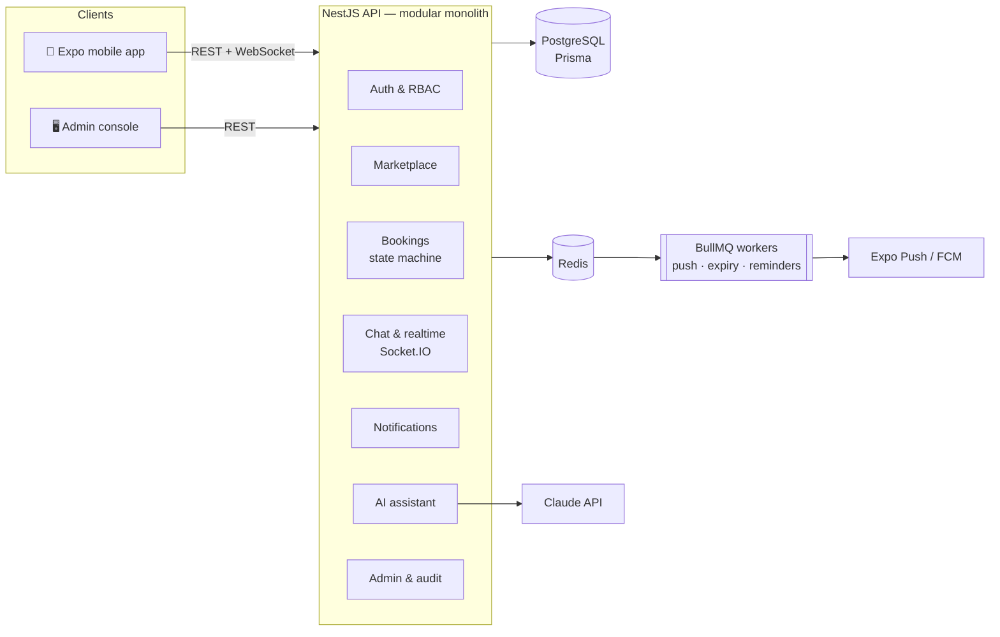

# FixMate — Home Services Marketplace 🇱🇰

[](https://github.com/Punujalokith/fixmate/actions/workflows/ci.yml)

FixMate connects customers in Sri Lanka with trusted local professionals — plumbers, electricians, AC technicians, cleaners and more. Customers describe a problem in plain words, an **AI assistant** works out which service they need, and they book a verified provider in a few taps. Providers manage jobs, services, working hours and earnings from the same app, and admins run the platform from a web console.

| Part | Tech | Folder |
|---|---|---|
| **Mobile app** (customers + providers) | React Native · Expo SDK 57 · Expo Router · TypeScript · TanStack Query · Zustand · Socket.IO | [`mobile/`](mobile) |
| **REST + real-time API** | NestJS 12 · TypeScript · PostgreSQL · Prisma 7 · Redis · BullMQ · Socket.IO · Claude API | [`backend/`](backend) |
| **Admin console** | React 19 · Vite · Tailwind CSS 4 · TanStack Query · Recharts | [`admin/`](admin) |

---

## Features

**Customers**
- Browse 8 service categories, search with filters (city, price, rating) and infinite scroll
- **AI Service Assistant** — "My washing machine is making a loud noise" → category, urgency, safety advice, follow-up questions and matching providers
- Book using the provider's real working hours (Sri Lanka time), saved addresses and notes
- Live booking status, in-app chat with read receipts and typing indicator, push notifications
- Reviews and ratings, favourites, profile photo upload

**Providers**
- Business profile with logo, services with fixed / hourly / inspection pricing, weekly hours
- Accept, decline, start and complete jobs; clash detection prevents double-booking
- Earnings dashboard with a 6-month chart; reply to reviews

**Admins**
- Platform overview (revenue, bookings, completion rate, charts)
- Suspend users (instantly revokes their sessions), verify / hide providers, moderate reviews
- Manage categories, monitor AI usage (tokens, latency, errors), full audit log

**Engineering highlights**
- JWT access tokens + **rotating refresh tokens with reuse detection** (a stolen token logs the attacker *and* the victim out everywhere)
- Role-based access control (Customer / Provider / Admin) with global guards
- Booking **state machine** with optimistic locking, status history and role-checked transitions
- **Background jobs** (BullMQ on Redis): push notifications with retries, delayed booking expiry, reminders + a cron safety-net
- **Real-time** Socket.IO gateway authenticated with the same JWT, per-user rooms
- AI with **structured JSON output**, low-effort setting for speed/cost, refusal fallback, offline keyword fallback, every call logged
- Rate limiting, Redis caching, validated config, magic-byte file validation, audit logging
- 23 unit tests + 39 end-to-end tests on an isolated test database, GitHub Actions CI, Docker

---

## Architecture



Booking lifecycle:

```
PENDING ──accept──▶ ACCEPTED ──start──▶ IN_PROGRESS ──complete──▶ COMPLETED
   │ reject / auto-expire   │ cancel            │ cancel (admin only)
   ▼                        ▼                   ▼
REJECTED / EXPIRED       CANCELLED           CANCELLED
```

---

## Run it on your laptop

**You need:** Node.js 24+, Docker Desktop, and (for the phone) the **Expo Go** app.

### 1. Databases
```bash
docker compose up -d
```
Starts PostgreSQL (port **5433**) and Redis (port **6380**).

### 2. API
```bash
cd backend
cp .env.example .env        # then put a long random value in JWT_ACCESS_SECRET
npm install
npm run db:migrate          # create tables
npm run db:seed             # demo data
npm run start:dev
```
- API: http://localhost:3000/api/v1
- **Swagger docs:** http://localhost:3000/api/docs
- Optional: put an Anthropic API key in `ANTHROPIC_API_KEY` to switch the assistant from keyword mode to Claude.

### 3. Mobile app
```bash
cd mobile
npm install
npx expo start
```
Scan the QR code with Expo Go (phone and laptop on the same Wi-Fi). Press **w** to open it in a browser instead.

### 4. Admin console
```bash
cd admin
npm install
npm run dev
```
Open http://localhost:5173

### Demo accounts (development only)
| Role | Email | Password |
|---|---|---|
| Customer | `customer@fixmate.lk` | `Customer@123` |
| Provider | `provider@fixmate.lk` | `Provider@123` |
| Admin | `admin@fixmate.lk` | `Admin@12345` |

Other seeded providers: `kasun@`, `dilshan@`, `ruwan@`, `sanduni@`, `chaminda@`, `tharindu@`, `ishara@` (all `@fixmate.lk`, password `Provider@123`).

---

## Tests

```bash
cd backend
npm test            # unit tests
npm run test:e2e    # end-to-end tests (uses a separate fixmate_test database)
```

The e2e suite boots the real app and covers auth & token rotation, RBAC, search, the full booking lifecycle, clash detection, auto-expiry, Socket.IO chat, admin moderation, the AI assistant and file-upload security.

---

## Deploy

| Piece | Suggested free option |
|---|---|
| PostgreSQL | [Neon](https://neon.tech) |
| Redis | [Upstash](https://upstash.com) (`rediss://` URL) |
| API + admin | [Render](https://render.com) using [`render.yaml`](render.yaml) (Blueprint) |
| Android app | `npx eas-cli build -p android --profile preview` → installable APK |

After deploying the API, set `EXPO_PUBLIC_API_URL` in [`mobile/eas.json`](mobile/eas.json) to its URL. For real push notifications, run `npx eas-cli init` (adds the project id) and upload your FCM credentials to Expo. Uploaded files are stored on local disk; on hosts with ephemeral disks, attach a persistent disk or swap `StorageService` for S3 / Cloudflare R2.

---

## Project structure

```
backend/
  prisma/            schema, migrations, seed
  src/
    auth/            register, login, rotating refresh tokens
    users/           profile, addresses, favourites, devices
    marketplace/     businesses, services, availability, search, dashboard
    bookings/        state machine, reviews, timers (BullMQ + cron)
    chat/            REST + Socket.IO chat
    realtime/        Socket.IO gateway, per-user rooms
    notifications/   in-app list + push queue (Expo / FCM)
    ai/              Claude assistant + keyword fallback
    admin/ audit/    admin API, audit log
    files/           uploads with type sniffing
  test/              e2e tests
mobile/src/
  app/               screens (Expo Router)
  components/ lib/ store/
admin/src/
  pages/ components/ lib/
```
